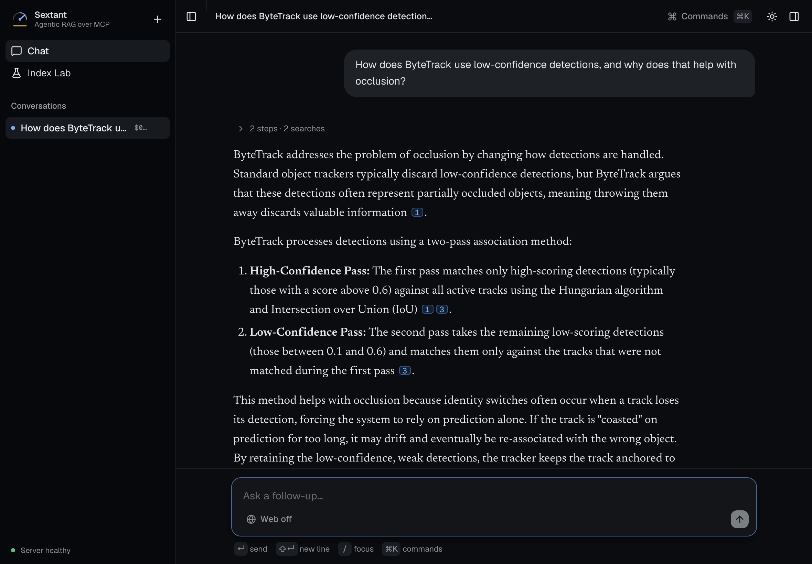

# sextant

Search your own documents from any AI assistant — and see the numbers that
say how well the search works.

sextant is a knowledge base that runs on your own machine as a standard
[Model Context Protocol](https://modelcontextprotocol.io) server. Point it at
a folder of PDF, Markdown or text files, plug it into Claude Desktop or any
other MCP client, and ask. Answers come from your documents and name the file
and the page.



*A real answer from the project's own web interface (2026-11-12). Each
numbered marker opens the passage it came from.*

## Quickstart

Four steps. Most of the time is two downloads — about 360 MB of libraries,
then about 180 MB of search models — which took two minutes on a fast
connection when last measured (2026-11-12). No account and no key. It needs
Python 3.11 or newer — check first, because an older one fails with a
confusing "no matching distribution" message:

```bash
python3 --version
```

**1. Install it** into a folder of its own, so its location is known:

```bash
python3 -m venv ~/sextant
```

```bash
~/sextant/bin/pip install sextant-kb
```

**2. Add your documents** — any folder of PDF, Markdown or text files:

```bash
~/sextant/bin/sextant-ingest ~/Documents/notes -r
```

The first run downloads the search models, once. A note about a missing
`GEMINI_API_KEY`, or a warning about `HF_TOKEN`, is expected and harmless:
the first only means documents are stored without an optional model-written
overview. Searching happens on your machine; the passages it finds go to
whichever assistant you plug it into.

**3. Plug it into your assistant.** In Claude Desktop: Settings → Developer →
Edit Config, then add this and restart the app. The command must be a full
path; `echo ~/sextant/bin/sextant-kb` prints yours.

```json
{
  "mcpServers": {
    "knowledge-base": {
      "command": "/Users/you/sextant/bin/sextant-kb"
    }
  }
}
```

**4. Ask.** For example: *"Search my knowledge base — what do my notes say
about onboarding?"* The assistant calls the search tool and answers from your
documents, with the source of each passage.

To see what is indexed, or take a document back out:

```bash
~/sextant/bin/sextant-forget --list
```

Any other MCP client works the same way: its server command is the full path
to `sextant-kb`. On Windows the config file is
`%APPDATA%\Claude\claude_desktop_config.json` and a virtual environment keeps
its commands in `Scripts\` rather than `bin/`; this project has not been
tested on Windows.

## What your assistant gets

| Tool | Does |
| --- | --- |
| `kb_search` | Finds the passages that answer a question, ranked, with source and page |
| `kb_list` | Lists every document with its title, size and what it is about |
| `kb_ingest` | Adds documents; re-using an id replaces the old version |
| `kb_stats` | Library size, search model, where it is stored |
| `kb_ann_benchmark`, `kb_ann_compare` | Compare index types on your own library |

Your library is stored in your user-data folder (set `SEXTANT_CHROMA_DIR` to
move it), never inside the install, so reinstalling does not lose it.

## How good is the search

Measured, on a committed test set, and re-checked on every change:

<!-- results:start -->
| Search stage | Right passage first |
| --- | --- |
| Meaning search only | 87% |
| Keyword search only | 78% |
| Both, fused | 91% |
| Both, fused, then re-read (the shipped pipeline) | **93%** |

65 test questions over 21 documents. Asked 10 questions those documents cannot answer, it declines 8.
<!-- results:end -->

The full comparison, the nine ideas that were measured and rejected, and what
a question costs are on one page: [`docs/RESULTS.md`](docs/RESULTS.md). Every
figure there is generated from the measurement files.

## The full app (optional)

The package above is the reusable part. This repository also holds what is
built on it: an agent that decides for itself what to look up, a web
interface with clickable citations, and the evaluation tools. That part needs
a Gemini API key, which is the only key the project reads.

```bash
git clone https://github.com/hulagerushikesh/sextant && cd sextant
```

```bash
python3 -m venv .venv && ./.venv/bin/pip install -e ".[dev]" && (cd frontend && npm install)
```

```bash
cp .env.example .env
```

Add your key to `.env`, then:

```bash
./start_all_services.sh
```

The interface opens on http://localhost:3000. Or run both halves in
containers with `docker compose up --build`. Details, every setting and the
HTTP routes are in [`docs/running.md`](docs/running.md).

## Honest status

Last checked 2026-11-12.

| What | State |
| --- | --- |
| Search over your own documents: PDF, Markdown, text; add, replace, remove | Working |
| Standard MCP server, published as `sextant-kb` | Working — 0.9.0 published; this tree is 0.9.1, not yet published |
| Measured search quality with a check on every change | Working |
| Agent, web interface, citations, cost per question, daily spend cap | Working |
| Each person's uploads kept apart on a shared deployment | Working — proven on a hosted box 2026-11-04 |
| Hosted demo | Off by default; started on demand |
| Used by anyone outside the project | Not yet — see [`planning/PLAN.md`](planning/PLAN.md) |

Known limits, stated plainly, are in [`docs/known-issues.md`](docs/known-issues.md).
The two that matter most to a new user: a scanned PDF with no text layer is
refused rather than read, and the test questions were written alongside the
test documents, so the numbers grade the search pipeline, not your library.

## Read more

| Page | What is in it |
| --- | --- |
| [`docs/RESULTS.md`](docs/RESULTS.md) | The numbers, and what was rejected |
| [`docs/how-it-works.md`](docs/how-it-works.md) | The agent loop, the search stages and why each exists, the model port |
| [`docs/running.md`](docs/running.md) | Setup, settings, routes, repository layout |
| [`docs/interface.md`](docs/interface.md) | What the web interface does and why |
| [`docs/known-issues.md`](docs/known-issues.md) | Limits and deliberate trade-offs |
| [`docs/history.md`](docs/history.md) | The roadmap as it was built, phase by phase |
| [`learning/`](learning/) | A study path, plus the note behind every measurement |
| [`planning/`](planning/) | The plan, progress and cost |

## Credits

Started as [SudhanshuR37/AgenticRAG](https://github.com/SudhanshuR37/AgenticRAG)
with Sudhanshu Randive; rebuilt from the ground up in September 2026 and
renamed from *AgenticRAG* in 0.7. MIT licensed — see [`LICENSE`](LICENSE).
PDF reading uses PyMuPDF, which is AGPL-licensed.
